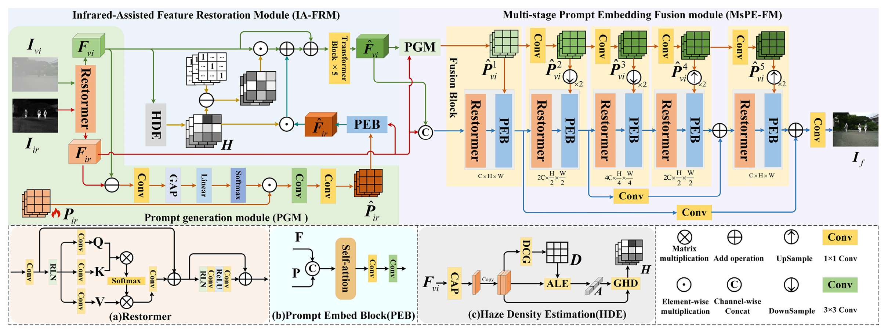
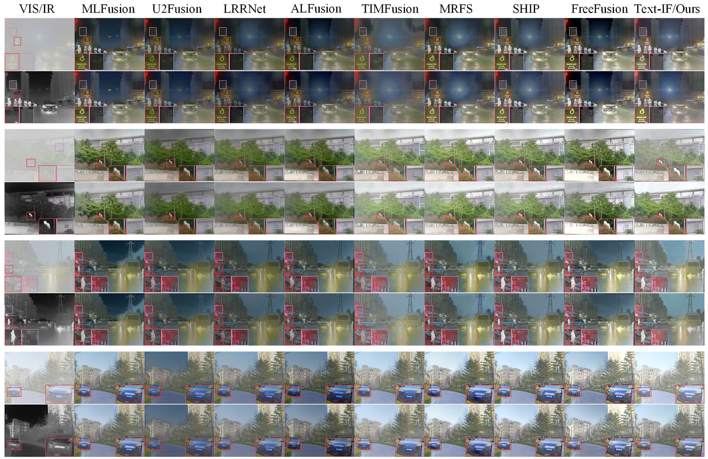
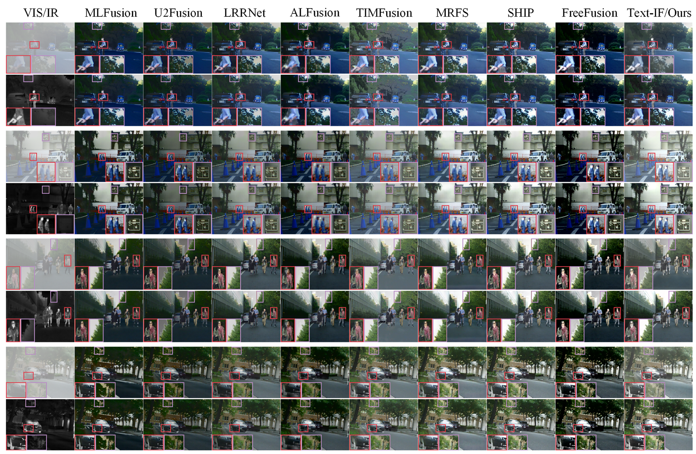
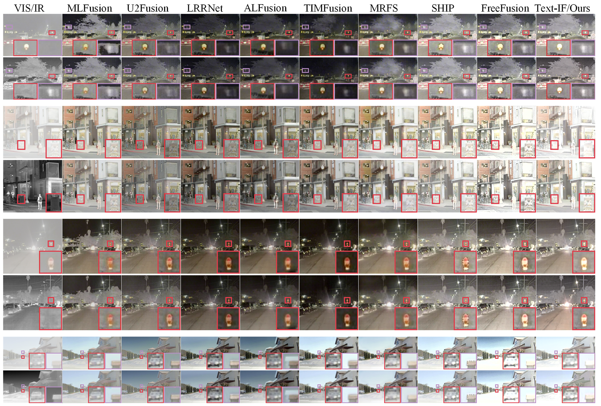
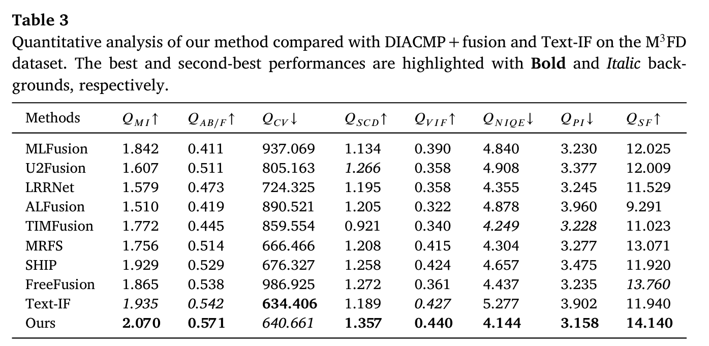
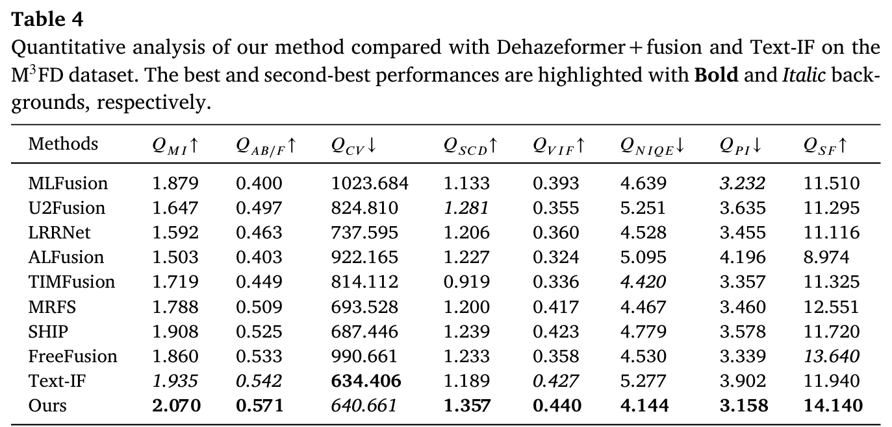
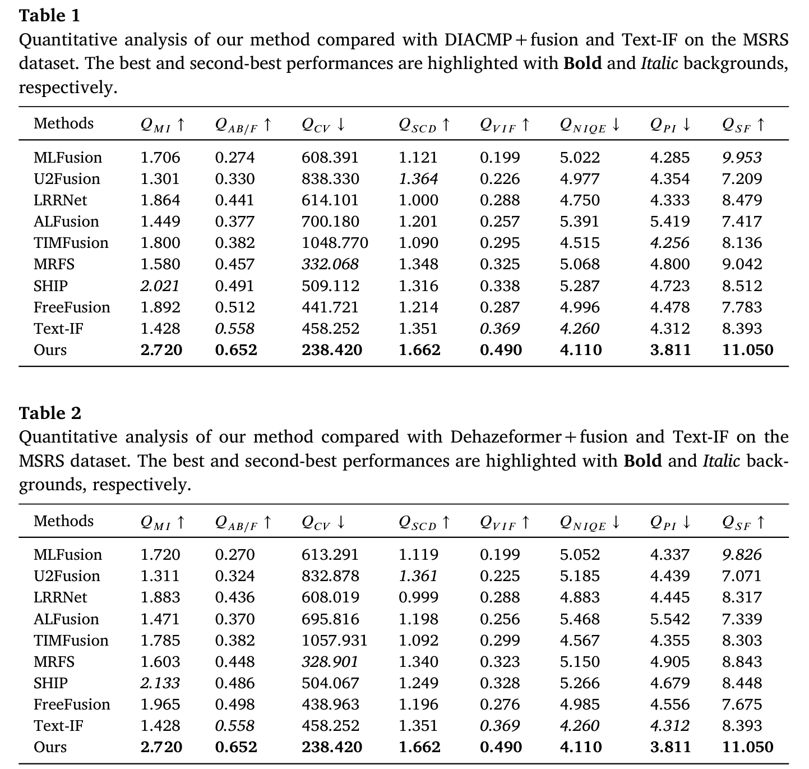
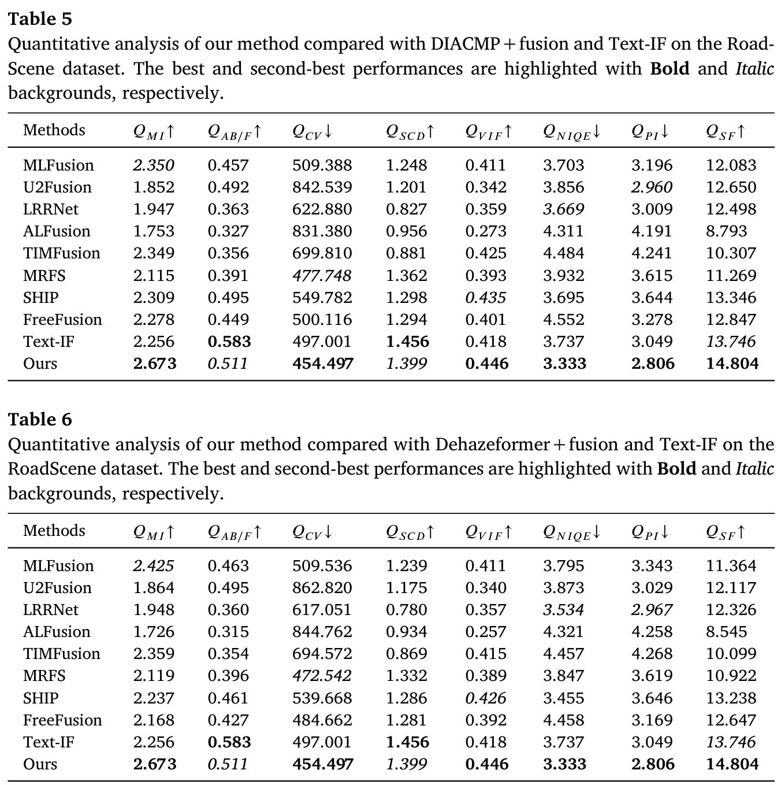

# Infrared-Assisted Single-Stage Framework for Joint Restoration and Fusion of  Visible and Infrared Images under Hazy Conditions (IASSF) [Pattern Recognition, 2026]
# Li, Huafeng and Fang, Jiaqi and Zhang, Yafei and Liu, Yu


## Method

<p align="center">
  
</p>

## Visual Comparisons

### Results on the M3FD Dataset

<p align="center">
  
</p>

### Results on the MSRS Dataset

<p align="center">
  
</p>

### Results on the RoadScene Dataset

<p align="center">
  
</p>

## Quantitative Comparisons

### Results on the M3FD Dataset

<p align="center">
  
</p>

<p align="center">
  
</p>

### Results on the MSRS Dataset

<p align="center">
  
</p>

### Results on the RoadScene Dataset

<p align="center">
  
</p>

## Ablation Study

<p align="center">
  
</p>

## Model Complexity Analysis

<p align="center">
  
</p>


1. Install PyTorch 1.10.2 and torchvision 0.11.3.
    ```bash
    conda install -c pytorch pytorch torchvision
    ```

2. Install the other dependencies.
    ```bash
    pip install -r requirements.txt
    ```
    
## Prepare

The final file path should be the same as the following (please check it carefully):
```
┬─ save_models
│   ├─ iassf
│   │   ├─ IASSF.pth
│   │   └─ ... (model name)
│   └─ ... (exp name)
└─ data
    ├─ MSRS
    │   ├─ train
    │   │   ├─ GT
    │   │   │   └─ ... (image filename)
    │   │   └─ hazy
    │   │   │   └─ ... (image filename)
    │   │   └─ IR
    │   │       └─ ... (image filename)
    │   └─ test
    │   │   ├─ GT
    │   │   │   └─ ... (image filename)
    │   │   └─ hazy
    │   │   │   └─ ... (image filename)
    │   │   └─ IR
    │   │       └─ ... (image filename)   
    └─ ... (dataset name)
```
## Notice

Due to GitHub’s upload size limit for individual files, we have split the model weights into three parts. If you need to perform testing, you must first combine 'IASSF_part_aa', 'IASSF_part_ab', and 'IASSF_part_ac' using the command below before proceeding with the tests.

```sh
cat saved_models/iassf/IASSF_part_* > saved_models/iassf/IASSF.pth
```

## Training

To customize the training settings for each experiment, navigate to the `configs` folder. Modify the configurations as needed.

After adjusting the settings, use the following script to initiate the training of the model:

```sh
CUDA_VISIBLE_DEVICES=X python train.py --model (model name) --dataset (dataset name) --exp (exp name)
```

For example, we train the IASSF on the MSRS:

```sh
CUDA_VISIBLE_DEVICES=0 python train.py --model iassf --dataset MSRS --exp iassf
```

## Testing

Run the following script to evaluate the trained model with a single GPU.


```sh
CUDA_VISIBLE_DEVICES=X python test.py --model (model name) --dataset (dataset name) --exp (exp name)
```

For example, we test the IASSF on the MSRS:

```sh
CUDA_VISIBLE_DEVICES=0 python test.py --model iassf --dataset MSRS --exp iassf
```
## Any Question

If you have any other questions about the code, please email to fangjiaqi@mail.hfut.edu.cn or fangjiaqi0909@outlook.com

## Citation

```
@article{zhang2026infrared,
  title={Infrared-assisted single-stage framework for joint restoration and fusion of visible and infrared images under hazy conditions},
  author={Zhang, Yafei and Liu, Yu and others},
  journal={Pattern Recognition},
  pages={113074},
  year={2026},
  publisher={Elsevier}
}
```

## License

This repository is released for academic research purposes only.
